# e-HADIR TUARAN — Database Entity Relationship Diagram (ERD)

## PPD Tuaran Admin Portal Architecture

```mermaid
erDiagram
    PROFILES ||--o{ USER_ROLES : "has"
    ROLES ||--o{ USER_ROLES : "defines"
    
    ZONES ||--o{ SCHOOL_ZONE_ASSIGNMENTS : "groups"
    SCHOOLS ||--o{ SCHOOL_ZONE_ASSIGNMENTS : "assigned to"
    
    PROFILES ||--o{ USER_SCHOOL_ASSIGNMENTS : "assigned to"
    SCHOOLS ||--o{ USER_SCHOOL_ASSIGNMENTS : "headed by"
    
    PROFILES ||--o{ ADMIN_ZONE_ASSIGNMENTS : "manages"
    ZONES ||--o{ ADMIN_ZONE_ASSIGNMENTS : "supervised by"
    
    SCHOOLS ||--o{ ATTENDANCE_LOCATIONS : "geofenced at"
    SCHOOLS ||--o{ ATTENDANCE_RECORDS : "recorded at"
    PROFILES ||--o{ ATTENDANCE_RECORDS : "clocks"
    
    ATTENDANCE_RECORDS ||--o{ ATTENDANCE_EVENTS : "consists of"
    ATTENDANCE_RECORDS ||--o{ JUSTIFICATIONS : "appeals"
    JUSTIFICATIONS ||--o{ JUSTIFICATION_DOCUMENTS : "substantiated by"
    
    PROFILES ||--o{ BIOMETRIC_PROFILES : "biometrics"
    PROFILES ||--o{ DEVICE_REGISTRY : "registers"
    
    SCHOOLS ||--o{ MONTHLY_ATTENDANCE : "aggregates"
    PROFILES ||--o{ MONTHLY_ATTENDANCE : "owner"
    
    SCHOOLS ||--o{ MONTHLY_APPROVER_ASSIGNMENTS : "delegated"
    ZONES ||--o{ MONTHLY_APPROVER_ASSIGNMENTS : "zone context"
    PROFILES ||--o{ MONTHLY_APPROVER_ASSIGNMENTS : "assigned approver"
    
    MONTHLY_ATTENDANCE ||--o{ MONTHLY_APPROVALS : "verified by"
    PROFILES ||--o{ MONTHLY_APPROVALS : "acted by"
    
    PROFILES ||--o{ AUDIT_LOGS : "triggered by"
    PROFILES ||--o{ NOTIFICATIONS : "receives"
```

### Table Definitions & Descriptions

| # | Table Name | Purpose | Key Constraints |
|---|---|---|---|
| 1 | `profiles` | User biographical & official info | Linked to `auth.users(id)` |
| 2 | `roles` | System roles (SUPER_ADMIN, ADMIN_ZON, MONITORING_ADMIN, PGB) | Unique `code` |
| 3 | `user_roles` | Role assignments | Composite unique `(user_id, role_id)` |
| 4 | `zones` | 6 administrative zones (Z01-Z06) | Unique `code`, custom hex color |
| 5 | `schools` | ~85 schools under PPD Tuaran | Unique MOE code, lat/lng, radius (50-500m) |
| 6 | `school_zone_assignments` | Maps school to zone | Unique active constraint `(school_id)` WHERE is_active=true |
| 7 | `user_school_assignments` | Maps PGB to school | Unique active constraint `(user_id)` WHERE is_active=true |
| 8 | `admin_zone_assignments` | Maps Admin Zon to their zone | Unique `(admin_id, zone_id)` |
| 9 | `admin_school_assignments` | Specific school oversight | Unique `(admin_id, school_id)` |
| 10 | `attendance_locations` | Physical coordinates & radius | Supports School + PPD Tuaran HQ |
| 11 | `geofence_settings` | Thresholds & GPS spoof detection | Min 50m, Max 500m, Default 100m |
| 12 | `attendance_records` | Daily attendance summaries | Unique `(user_id, date)` |
| 13 | `attendance_events` | Granular clock-in/out raw events | Haversine distance, face score, lat/long |
| 14 | `biometric_profiles` | Non-raw face template descriptors | Privacy-safe hash, re-enrolment workflow |
| 15 | `device_registry` | Bound mobile hardware | Unique `(user_id, device_uuid)` |
| 16 | `justifications` | Discrepancy appeals | Status: MENUNGGU, DISAHKAN, DITOLAK |
| 17 | `justification_documents` | Attachments for justification | PDF/JPG storage path |
| 18 | `monthly_attendance` | Monthly consolidated timesheet | Unique `(user_id, month, year)` |
| 19 | `monthly_approver_assignments` | Designated monthly approvers | Unique active `(school_id, month, year)` |
| 20 | `monthly_approvals` | Verification audit & stamp | Action: VERIFY, RETURN, REJECT |
| 21 | `work_schedules` | Working hours rules | 9 hours (540 mins), tolerance 15 mins |
| 22 | `holiday_calendar` | Gazetted holidays & school terms | Differentiates PGB working calendar |
| 23 | `system_settings` | Global administration configs | Key-value JSONB |
| 24 | `notifications` | System alerts & submission notices | Category, unread tracking |
| 25 | `audit_logs` | Tamper-proof security audit log | Old vs New values JSONB, immutable |
| 26 | `risk_alerts` | Automated anomaly detection | Geofence breach, mock GPS, unassigned |
| 27 | `submission_jobs` | Cron job execution history | Tracks batch monthly generation |
