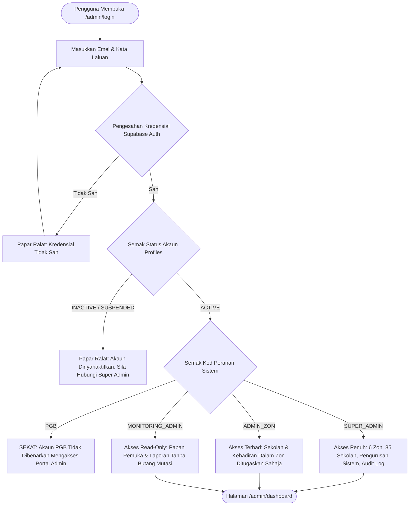
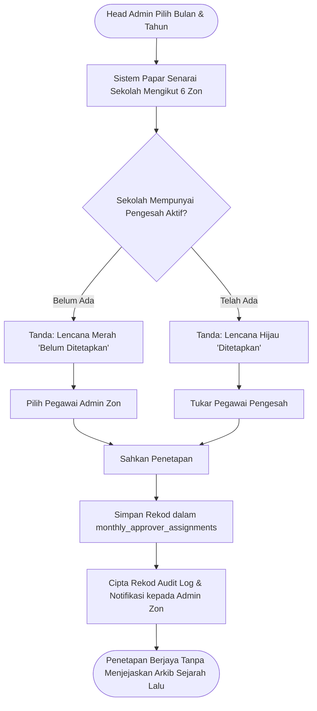
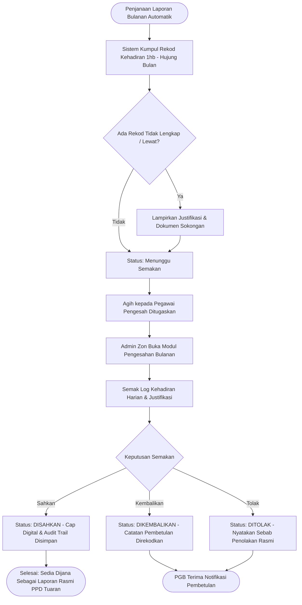

# e-HADIR TUARAN — Aliran Kerja Sistem Pentadbiran (Admin Flowcharts)

## 1. Aliran Log Masuk & Kawalan Akses Berperingkat (RBAC Flowchart)

## 2. Aliran Penetapan Pegawai Pengesah Bulanan (Monthly Approver Assignment)

## 3. Aliran Semakan & Pengesahan Kehadiran Bulanan

